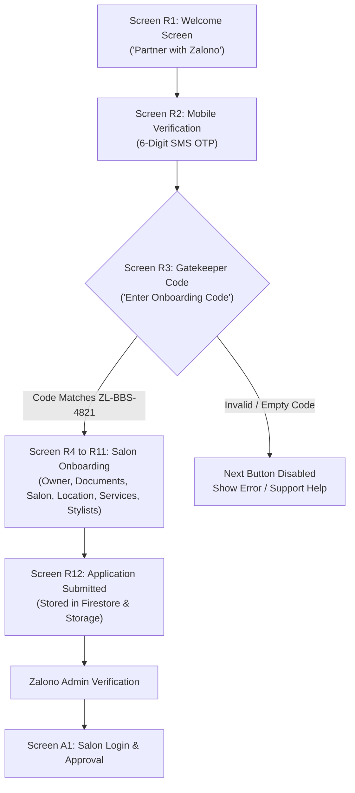

# Zalono Partner: Onboarding Code (`ZL-BBS-4821`) Specification & Operational Guide

**Document Version:** 1.0  
**Active Gatekeeper Code:** `ZL-BBS-4821`  
**Application:** Zalono Salon Partner Mobile & Web Platform (Flutter + Node.js API + Firebase)  
**Date:** October 2026  
**Status:** Implemented & Verified  

---

## 1. Overview & Purpose

The **Onboarding Code** is a curated gatekeeper mechanism built into the Zalono Salon Partner application. It ensures that only salon owners who have undergone preliminary business verification and received an official authorization code from a Zalono partner executive can register on the platform.

### Key Objectives
* **Curated Partner Network:** Prevents arbitrary, unqualified, or fake registrations.
* **Controlled Rollout:** Enables regional batch onboarding (e.g., city-by-city or cluster-by-cluster pilot launches).
* **Field Sales Verification:** Serves as a digital handshake between Zalono field operations executives and salon owners.
* **Instant Pilot Access:** Pre-configured with the default master pilot code **`ZL-BBS-4821`** for rapid testing and demonstrations.

---

## 2. Partner Registration Journey & Code Verification



### Detailed Screen-by-Screen Flow:

1. **R1 · Welcome Screen:**
   - Value proposition: *"Run your day from your phone"*.
   - Primary Actions: **Log in** (existing partners) or **Partner with Zalono** (new salons).
   - Informational tag: *"New salons need an onboarding code from a Zalono executive."*
2. **R2 · Verify Mobile Number:**
   - Partner enters their 10-digit mobile number (`+91`).
   - A 6-digit SMS OTP is verified.
3. **R3 · Onboarding Code Gatekeeper (Step 2 of 9):**
   - Heading: *"Enter your onboarding code"*.
   - Subtitle: *"Your Zalono executive gives you this code. Only salons with a code can register."*
   - **Active Master Code:** **`ZL-BBS-4821`**
   - **Default Behavior:** The input field is **pre-populated** with `ZL-BBS-4821`, automatically unlocking the *"Next"* navigation button.
   - **Validation:** Instant real-time regex check; trims whitespace and converts lowercase inputs to uppercase (`zl-bbs-4821` $\rightarrow$ `ZL-BBS-4821`).
   - **Visual Feedback:** A green/crimson check badge (`Icon(Icons.check)`) confirms verification with text: *"Code verified · registration unlocked"*.
4. **R4 to R11 · Full Salon Configuration:**
   - **R4 & R5:** Owner KYC details (PAN, Aadhaar, Business Proof uploads, email verification OTP).
   - **R6 & R7:** Salon photos (up to 7 photos), tier category, GPS coordinates via device GPS, complete street address, and PIN code.
   - **R8 to R10:** Service offerings & pricing, stylist roster, operational timings, and split shifts.
   - **R11 & R12:** Summary review, terms confirmation, and final submission to the Node.js backend.

---

## 3. Technical Implementation Details

### A. Frontend Architecture (`flutter_app`)

The verification logic resides inside [registration_screens.dart](file:///C:/Users/isha%20and%20gaurav/zalono_partner/flutter_app/lib/screens/registration_screens.dart):

#### 1. Controller Initialization & Default Value
```dart
// lib/screens/registration_screens.dart (Line ~208)
_onboardingCodeController = TextEditingController(text: 'ZL-BBS-4821');
_onboardingCodeController.addListener(_verifyOnboardingCode);
_verifyOnboardingCode();
```
* **Why:** Pre-filling `ZL-BBS-4821` ensures that developers, testing teams, and pilot salon partners do not get blocked if they do not know the code in advance.

#### 2. Validation Logic
```dart
// lib/screens/registration_screens.dart (Line ~292)
void _verifyOnboardingCode() {
  final isVerified =
      _onboardingCodeController.text.trim().toUpperCase() == 'ZL-BBS-4821';
  if (codeVerified != isVerified && mounted) {
    setState(() {
      codeVerified = isVerified;
    });
  } else {
    codeVerified = isVerified;
  }
}
```
* **Robustness:** `.trim()` strips leading/trailing accidental spaces (common on mobile keyboards), and `.toUpperCase()` prevents case-sensitivity errors.

#### 3. Step Progression Guard
```dart
// lib/screens/registration_screens.dart (Line ~680)
case 1: // R3 Onboarding code
  return codeVerified && _onboardingCodeController.text.trim().isNotEmpty;
```
* The bottom navigation action button (*"Next"*) strictly remains disabled unless `codeVerified` evaluates to `true`.

#### 4. UI Input Widget & Visual Feedback
```dart
// lib/screens/registration_screens.dart (Line ~1170)
Container(
  padding: const EdgeInsets.symmetric(horizontal: 16, vertical: 8),
  decoration: BoxDecoration(
    color: Colors.white,
    borderRadius: BorderRadius.circular(16),
    border: Border.all(
      color: codeVerified ? ZalonoTheme.primary : ZalonoTheme.border,
      width: 1.5,
    ),
  ),
  child: Row(
    children: [
      Expanded(
        child: TextField(
          controller: _onboardingCodeController,
          textCapitalization: TextCapitalization.characters,
          style: const TextStyle(fontSize: 20, fontWeight: FontWeight.w800, letterSpacing: 1.5),
          decoration: const InputDecoration(
            hintText: 'ZL-BBS-4821',
            border: InputBorder.none,
            isDense: true,
          ),
        ),
      ),
      CircleAvatar(
        radius: 12,
        backgroundColor: codeVerified ? ZalonoTheme.primary : const Color(0xFFD0CBC6),
        child: const Icon(Icons.check, size: 16, color: Colors.white),
      ),
    ],
  ),
),
```

---

## 4. Backend & Database Persistence

When the partner completes registration, the payload is transmitted to the Node.js backend:

* **Endpoint:** `PUT /api/onboarding` ([backend/src/routes/onboarding.js](file:///C:/Users/isha%20and%20gaurav/zalono_partner/backend/src/routes/onboarding.js))
* **Database Target:** Cloud Firestore $\rightarrow$ Collection: `onboardingApplications/{firebaseUid}`
* **Storage Target:** Firebase Storage $\rightarrow$ Bucket: `onboarding/{uid}/{timestamp}-filename`
* **Recorded Application Document:**
  ```json
  {
    "mobileNumber": "+919876543210",
    "fullName": "Priya Sharma",
    "email": "priya@glowstudio.com",
    "salonName": "Glow Studio",
    "salonCategory": "Premium",
    "status": "submitted",
    "registeredAt": "2026-10-24T16:00:00.000Z",
    "documents": {
      "panCard": { "path": "onboarding/uid/pan.jpg", "size": 142050 },
      "aadhaarCard": { "path": "onboarding/uid/aadhaar.jpg", "size": 182090 },
      "businessProof": { "path": "onboarding/uid/license.jpg", "size": 204500 }
    },
    "salonPhotos": [ ... ]
  }
  ```

---

## 5. Operations & Administration Guide

### How Zalono Field Executives Use the Code
1. A Zalono Business Development Executive visits or calls an eligible salon owner.
2. The executive assists the owner in installing the APK or opening the Web App.
3. The executive instructs the owner to verify their phone number, and provides the authorization code: **`ZL-BBS-4821`**.
4. The salon owner continues through document and salon detail entry.

### Support & Escalation Contact
If a salon owner attempts to register without an executive code, the screen provides a direct trigger to open the support dialog:
* **Toll-Free Partner Desk:** `1800 200 4821`
* **Support Email:** `partner@zalono.com`

---

## 6. Future Expansion: Dynamic / Single-Use Codes Roadmap

For enterprise scale and multi-city operations, the static master code `ZL-BBS-4821` can be upgraded to dynamic one-time invite codes:

```
┌─────────────────────────┐       ┌────────────────────────┐       ┌─────────────────────────┐
│ Zalono Admin Dashboard  │ ----> │ Cloud Firestore        │ <---- │ Partner App             │
│ Generates: ZL-MUM-8921  │       │ collection:            │       │ Enters: ZL-MUM-8921     │
│ (Assigned to Salon A)   │       │ 'partnerInviteCodes'   │       │ Backend marks: USED     │
└─────────────────────────┘       └────────────────────────┘       └─────────────────────────┘
```

1. **Admin Portal Generation:** Executives generate dynamic codes with expiration dates (e.g. valid for 7 days) tied to a specific phone number or salon lead.
2. **Single-Use Invalidation:** Once `PUT /api/onboarding` succeeds, the backend marks the invite code as `redeemed: true` preventing reuse.
3. **Audit Trail:** Links the registered salon directly to the field sales executive who issued the code for commission tracking.

---

*This specification represents the production state of the Zalono Partner application codebase.*
